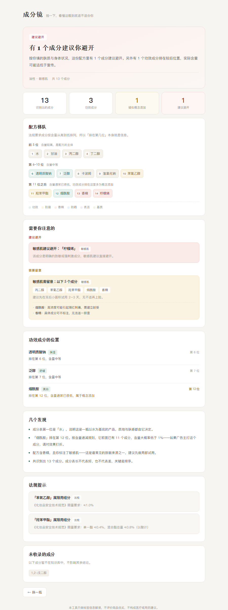
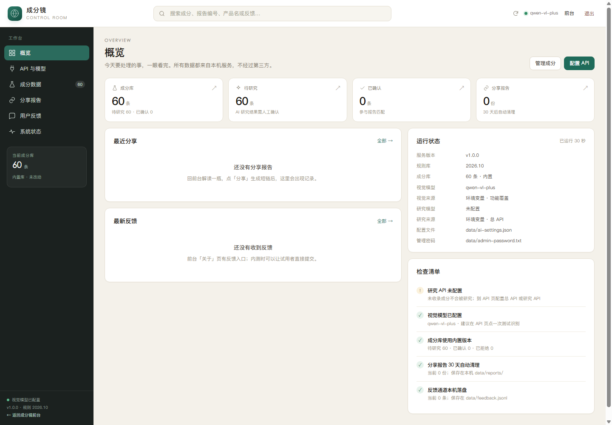
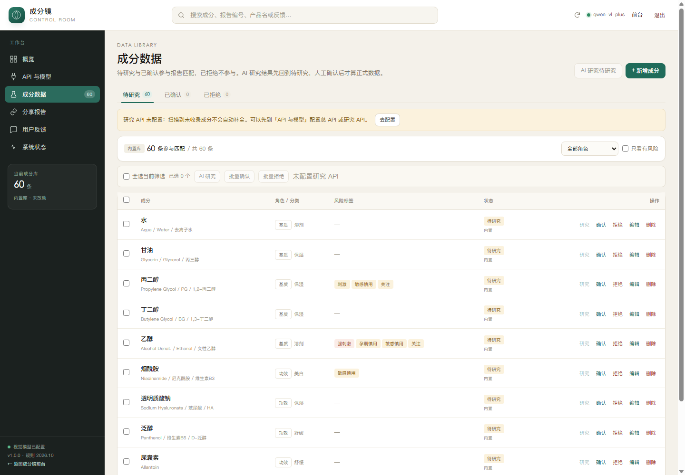
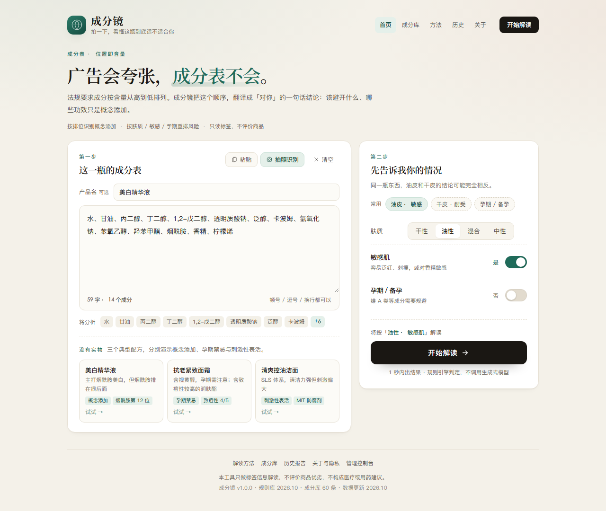
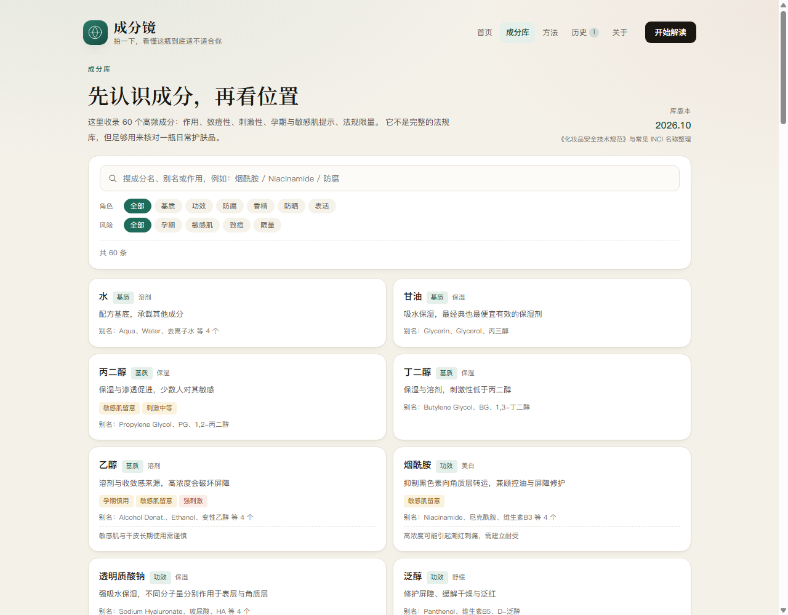

# 成分镜 · 拍一下，看懂这瓶到底适不适合你

把化妆品包装背面那一片没人看得完的小字，翻译成「对你」的结论：哪些成分该避开、哪些功效是概念添加、哪些限量需要注意。

> 全国高校 AI Web 开发挑战赛 · 本科 B 组
> 当前状态：v1.0 产品化原型
> 产品化差距、指标与路线图：[docs/04-产品化清单.md](docs/04-产品化清单.md)
>
> 3 分钟投稿视频（屏幕演示 + Breeze-TTS-2 madara 音色 + 逐句字幕）：[docs/03-成分镜_3分钟投稿版_madara.mp4](docs/03-成分镜_3分钟投稿版_madara.mp4)。**注意：赛项要求演示视频 5–8 分钟，3 分钟版只能当补充素材。**
>
> 省赛提交版演示视频脚本（7:10，按评分表逐段对齐、含口播/分镜/导出参数）：[docs/05-演示视频脚本-省赛版.md](docs/05-演示视频脚本-省赛版.md)
>
> 自动生成的演示片（5:37 · 1080p · 小鲸鱼配音 · 硬字幕）：[docs/07-成分镜-完整版.mp4](docs/07-成分镜-完整版.mp4)，流水线说明见 [docs/06-视频自动化流水线.md](docs/06-视频自动化流水线.md)



---

## 它解决什么问题

成分表不会骗人，广告会。

法规要求成分按含量从高到低排列（含量 ≤0.1% 者可任意排列）。这条规则公开、可验证，但几乎没人用它做推理。于是出现一个所有人都遇到过的情况：

> 一瓶号称「烟酰胺美白」的精华，烟酰胺排在第 12 位。它前面还有 11 个成分，含量都不低于它——它不可能是这瓶产品的主要功效成分。名字印在正面、含量排在后段，这就是我们说的**概念添加**（位次判断，不是浓度测量）。

成分镜做的事，就是把「排在第几位」这个位置信息翻译成用户能立刻理解的结论，并按用户自己的肤质、敏感史、孕期状态重新排序风险。

## 当前已实现

- [x] 成分表文本输入与切分（兼容「1,2-戊二醇」这类数字逗号）
- [x] 60 个高频成分知识库：作用、致痘性、刺激性、孕期/敏感肌禁忌、法规限量
- [x] 成分匹配：标准名 → 别名表 → 包含匹配 → 英文编辑距离兜底
- [x] 配方梯队推断：前 5 / 6–10 / 11 位之后三档，识别概念添加
- [x] 个体化规则引擎：肤质、敏感肌、孕期三组条件
- [x] 同类风险自动合并，避免制造新的信息噪音
- [x] 报告页：结论卡、配方梯队可视化、风险分组、功效成分定位、法规提示、待补全占位
- [x] 三个示例配方，无网络也能完整演示
- [x] 拍照识别接口（需配置视觉模型密钥）：一次返回成分表与产品名，前端在产品名为空时自动填入

**交互与体验**

- [x] 双栏输入页：粘贴 / 拍照 / 示例三个入口，输入时实时显示「会切出几个成分」；拍照识别到产品名且输入框为空时自动填入
- [x] 格式自检：识别不出分隔符时提示，并支持「按空格切分」一键修复（OCR 结果常见）
- [x] 档案预设（油皮·敏感 / 干皮·耐受 / 孕期）与本地记忆，刷新不丢肤质和上次的成分表
- [x] 报告页内直接改档案，保留旧结论、后台重算，并说明「风险成分 6 → 2」这类变化
- [x] 结论可信度保护：全部未识别显示「未能解读」，识别不足显示「信息不足」，不会把「没认出来」误报成「可以放心」
- [x] 待补全成分在梯队图中占虚线占位，排位不跳号；报告不再展示未识别名单
- [x] 报告成分详情：点击梯队成分、功效成分或风险提示里的成分名，弹出成分详情卡（深度描述、风险、排位、别名、备注），支持 Esc / 点击遮罩关闭
- [x] 移动端底部固定主操作、拍照预览与失败重试、报告锚点导航
- [x] 一键复制报告（局域网 HTTP 下提供「已全选」兜底弹层）与打印样式
- [x] 管理控制台 `#/admin`：顶栏 logo + 全局搜索、深色侧栏、主区域，登录后进入
- [x] 控制台概览：成分库 / 待研究 / 已确认 / 分享 KPI，最近分享与反馈、运行状态、检查清单
- [x] API 与模型：总 API + 视觉 API + 研究 API；留空字段逐项回退总 API；拉取模型、视觉测试、研究测试、保存即生效
- [x] 成分数据：待研究 / 已确认 / 已拒绝三态；60 条表格、搜索 / 角色 / 风险筛选、新增、编辑、删除、批量审核、恢复内置库；表格新增「深度描述」和「添加时间」列，默认最新添加在最顶
- [x] 成分排序：最新添加 / 最早添加 / 名称 A–Z；新增后自动切到对应状态页的第一页，最新记录置顶
- [x] 成分 AI 研究：单条 / 批量 / 研究全部待研究（单次最多 10 个）；结果带置信度、依据和一段 2–4 句深度描述，先待研究再人工确认
- [x] 扫描自动补全：未收录 token 先进入 **研究任务队列**，后台 worker 自动研究、写库；失败保留错误并可重试，报告在队列完成后自动刷新
- [x] 研究队列：管理员可查看原始名称、状态、尝试次数、错误、来源上下文；支持重试全部失败、单条重试/删除
- [x] 前台成分库卡片：有 AI 深度描述时优先展示完整描述与「AI 深度研究」标记；否则回退一句话作用
- [x] 分享报告：列表、打开、复制短链、删除；反馈：列表与搜索；系统：版本、路径、接口与安全边界
- [x] 管理令牌只存在内存（12 小时）；统计 / 分享 / 反馈 / 成分写 / AI 配置接口都要求 Bearer 令牌
- [x] 产品化：成分库（60 条可搜索/筛选）、解读方法、关于与隐私、历史报告、404
- [x] 报告资产化：产品名、分析编号、生成时间、规则库版本，本机历史最近 20 份，短链接分享
- [x] 版本与健康接口、PWA manifest / OG 分享图、后端规则引擎回归测试

## 管理控制台

`http://localhost:5173/#/admin`，密码在 `~/.cosme/data/admin-password.txt`（也可用 `ADMIN_PASSWORD` 指定）。

- **布局**：顶栏 logo + 全局搜索 + 刷新 + 视觉状态 + 退出；左侧深色导航；右侧主区域。手机端侧栏变成抽屉。
- **概览**：成分库 / 待研究 / 已确认 / 分享四个 KPI，最近分享、最新反馈、运行状态、检查清单。
- **API 与模型**：总 API 是默认值；视觉 / 研究留空的字段逐项回退总 API。支持拉取模型、视觉假标签测试、研究 JSON 测试，保存立即生效。
- **成分数据**：待研究 / 已确认 / 已拒绝三个页签；支持搜索、角色、风险筛选、排序（最新添加 / 最早添加 / 名称 A–Z）、全选/批量审核、单条与批量 AI 研究、编辑、删除、恢复内置库。表格列为：成分、**深度描述**、角色/分类、风险标签、**添加时间**、状态、操作；默认最新添加在最顶，新增后自动回到对应状态页第一页。
  - 新成分写入 `ct` / `ut`；内置 60 条没有真实录入时间，用库版本月份（2026-10-01）作为稳定回退值，并在表格标注「内置库」。
  - 编辑只更新 `ut`，不会把老成分顶到最新；AI 新建成分按创建时间排到最前。
  - 深度描述在编辑弹窗可手改；AI 研究成功后，模型返回的 2–4 句描述会覆盖这个字段，并在前台成分卡片展示。
  - 描述留空时前台卡片回退显示一句话「作用」。
  - 待研究与已确认参与报告匹配；已拒绝只保留审计，不参与匹配。
  - 原始 60 条成分进入「待研究」；AI 研究结果也先回「待研究」，参与匹配并在报告注明 AI 补全，人工确认后转为「已确认」。
  - AI 结果会带置信度、研究模型与依据，方便复核；改动写 `~/.cosme/data/ingredients.json`，立即重建索引。
- **研究任务**：扫描到的未收录 token 会先进入 `~/.cosme/data/research-tasks.json`，后台 worker 自动研究；失败任务带错误、尝试次数和重试时间，可单条或批量重试。研究 API 未配置时任务也会保留，不会无声消失。
  - 同一成分的括号变体会自动并入已有成分：例如 `(日用)香精` 研究出标准名 `香精` 时，不再因重名失败，而是把 `(日用)香精` 写成 `香精` 的别名，任务直接完成，报告重新分析即可匹配。
- **扫描自动补全**：`/api/analyze` 先把未收录 token 入队，后台研究成功后写回待研究库；报告自动轮询并在完成后刷新。报告不出现未识别名单，只显示「待补全」占位、研究队列状态和「AI 已补全」提示。
- **分享报告**：列表、打开、复制短链、删除；**用户反馈**：按时间倒序查看与搜索；**系统状态**：版本、运行时长、数据文件路径、公开接口与安全边界。
- **搜索**：顶栏全局搜索成分 / 报告编号 / 产品名 / 反馈，点结果直接跳到对应模块，并自动切到该成分的审核状态页签。
- **安全**：管理令牌只存在内存，12 小时有效；统计、分享、反馈、成分写、AI 配置接口全部要求 Bearer 令牌。数据都落在本机数据目录（默认 `~/.cosme/data`），不接第三方。





## 尚未实现

- [ ] 视觉模型需自备支持看图的 Key（可在管理控制台 `#/admin` 配置）
- [ ] 研究 API 需自备支持 JSON 输出的文本模型 Key（不配置时任务仍入队，但不会自动处理）
- [ ] 报告解释交给 LLM（当前为模板生成；AI 目前只用于成分研究，不参与风险判定）
- [ ] 成分库扩充到 400+
- [ ] 双品对比、替代品推荐
- [ ] MCP 工具封装

---

## 技术栈

| 层 | 选型 | 说明 |
|---|---|---|
| 前端 | Vue 3 + Vite | 组件化，无 UI 框架依赖，样式手写 |
| 后端 | Spring Boot 2.7.18 | 本机 JDK 11，故不用 3.x |
| 成分库 | JSON + 内存索引 | 预审版；正式版迁 MySQL |
| 视觉 | OpenAI 兼容协议 | 通义千问 VL / GLM-4V / 硅基流动均可 |

## 目录结构

```
AIWEB/
├── server/                      Spring Boot 服务（端口 8082）
│   ├── src/main/
│   │   ├── java/com/cosme/
│   │   │   ├── CosmeApplication.java
│   │   │   ├── AppMeta.java                     版本号单一来源
│   │   │   ├── controller/
│   │   │   │   ├── ApiController.java           分析 / 成分库 / 版本 / 健康 / 研究入队
│   │   │   │   ├── AdminController.java         登录、AI 配置、统计、分享、反馈
│   │   │   │   ├── AdminIngredientController.java 成分列表 / 增删改 / 审核 / 研究 / 恢复内置库
│   │   │   │   ├── AdminResearchTaskController.java 研究任务列表 / 重试 / 删除
│   │   │   │   ├── ShareController.java         分享报告短链
│   │   │   │   └── FeedbackController.java      本机反馈
│   │   │   └── service/
│   │   │       ├── IngredientRepository.java    成分库、匹配、状态、自定义覆盖与热重载
│   │   │       ├── IngredientAdminService.java  控制台成分校验、审核与 AI 结果落盘
│   │   │       ├── AnalyzeService.java          规则引擎与报告
│   │   │       ├── AiSettings.java              总 API / 视觉 / 研究配置对象
│   │   │       ├── AiSettingsStore.java         配置落盘 data/ai-settings.json
│   │   │       ├── AiConfigService.java         配置归并、热更新与掩码快照
│   │   │       ├── ResearchService.java         OpenAI 兼容成分研究、JSON 解析与并行批量
│   │   │       ├── ResearchTask.java            未收录成分的研究任务模型
│   │   │       ├── ResearchTaskStore.java       任务队列落盘 data/research-tasks.json
│   │   │       ├── ResearchTaskWorker.java      后台认领任务、研究写库、失败重试
│   │   │       ├── ResearchException.java       可读的研究错误
│   │   │       ├── VisionService.java           拍照识别（走视觉 API / 总 API）
│   │   │       ├── VisionSettings.java          单个 API 端点配置
│   │   │       ├── VisionSettingsStore.java     旧版视觉配置兼容读取
│   │   │       ├── VisionException.java         可读的视觉错误
│   │   │       ├── AdminAuthService.java        管理密码与令牌
│   │   │       ├── ReportStore.java             分享报告落盘 data/reports/
│   │   │       └── FeedbackStore.java           反馈落盘 data/feedback.jsonl
│   │   ├── resources/ingredients.json           成分知识库
│   │   └── test/java/com/cosme/service/         规则引擎回归测试
│   └── data/                                    本地配置与覆盖（已 gitignore）
├── web/                         Vue 3 应用（端口 5173）
│   ├── public/                 favicon / PWA 图标 / og.png / manifest
│   └── src/
│       ├── App.vue             壳层、路由、分析编排、历史与分享
│       ├── style.css           设计变量与公共样式
│       ├── lib/
│       │   ├── text.js         与后端一致的切分规则、输入体检
│       │   ├── report.js       结论视图、变化说明、复制文本
│       │   ├── history.js      本机报告历史（最近 20 份）
│       │   ├── admin.js        控制台等级/角色/风险标签
│       │   ├── format.js       日期、运行时长、文件大小
│       │   └── http.js         带超时与友好报错的请求封装
│       └── components/
│           ├── IntakePanel.vue       成分表输入、产品名、实时切分、示例
│           ├── ProfilePanel.vue      档案卡与主操作
│           ├── ProfileControls.vue   肤质/敏感/孕期控件（输入页与报告页共用）
│           ├── ReportView.vue        报告页、吸顶工具条、档案即时重算
│           ├── LadderChart.vue       配方梯队图（含待补全占位）
│           ├── IngredientDetail.vue  成分详情卡（深度描述 / 排位 / 别名）
│           ├── IngredientsView.vue   成分库（搜索 / 角色 / 风险筛选）
│           ├── MethodView.vue        解读方法
│           ├── AboutView.vue         关于、隐私、版本、反馈
│           ├── HistoryView.vue       历史报告
│           ├── AdminView.vue         控制台壳层：登录、顶栏、侧栏、全局搜索
│           ├── admin/
│           │   ├── admin.css                 控制台布局与组件样式
│           │   ├── AdminDashboard.vue        概览
│           │   ├── AdminApiPanel.vue         API 与模型
│           │   ├── AdminIngredients.vue      成分数据 CRUD
│           │   ├── AdminResearchTasks.vue    研究任务队列
│           │   ├── AdminReports.vue          分享报告
│           │   ├── AdminFeedback.vue         用户反馈
│           │   └── AdminSystem.vue           系统状态
│           ├── NotFoundView.vue      404 / 分享失效
│           └── AnimatedNumber.vue    数字过渡
├── video/                       演示视频自动化流水线（见 docs/06）
│   ├── narration.json           旁白：按段、按句
│   ├── tts-batch.ps1            逐句 TTS → audio/*.wav + durations.json
│   ├── build.mjs                生成分镜 / 时间轴 / 字幕 / 音频计划
│   ├── make-video.ps1           一条命令出片
│   ├── fix-shots.ps1            只重录指定镜头
│   ├── slides/                  技术卡静态页（vec.html / code.html）
│   └── shots/                   分镜 YAML 与片段（out/ 已 gitignore）
├── docs/
│   ├── 01-作品方案书.md
│   ├── 02-录屏脚本.md
│   ├── 03-成分镜_3分钟投稿版.mp4
│   ├── 03-成分镜_3分钟投稿版_madara.mp4
│   ├── 04-产品化清单.md
│   ├── 05-演示视频脚本-省赛版.md
│   ├── 05-口播提词.md
│   ├── 06-视频自动化流水线.md
│   ├── 07-成分镜-完整版.mp4
│   └── shot-*.png / new-*.png
└── start-server.bat / start-web.bat
```

---

## 快速启动

**环境要求**：JDK 11+、Maven 3.6+、Node 18+

```bash
# 终端 1：后端
cd server
mvn -DskipTests package
java -jar target/cosme-backend-1.0.0.jar

# 终端 2：前端
cd web
npm install
npm run dev
```

浏览器打开 **http://localhost:5173**（`127.0.0.1:5173` 也可）。

也可以直接双击根目录的 `start-server.bat` 和 `start-web.bat`。

**快速演示**：访问 `http://localhost:5173/?demo=1` 会自动跑通一条示例并直接展示报告；`?sample=2` / `?sample=3` 可直接打开另外两条示例。

页面入口：`#/ingredients` 成分库、`#/method` 解读方法、`#/history` 历史报告、`#/about` 关于与隐私、`#/admin` 管理控制台。

管理控制台：`http://localhost:5173/#/admin`。首次启动会自动生成管理密码到 `~/.cosme/data/admin-password.txt`（也可以用 `ADMIN_PASSWORD` 环境变量指定）。





### 数据存在哪

后端所有落盘内容（管理密码、AI 配置、成分库覆盖、研究队列、分享报告、反馈）都在**同一个数据目录**，由 `DataPaths` 统一解析：

| 优先级 | 方式 | 示例 |
|---|---|---|
| 1 | JVM 参数 | `java -Dcosme.data.dir=/srv/cosme -jar target/cosme-backend-1.0.0.jar` |
| 2 | 环境变量 | `COSME_DATA_DIR=/srv/cosme`（Windows：`set COSME_DATA_DIR=D:\cosme`） |
| 3 | 默认值 | Windows `C:\Users\<你>\.cosme\data`；macOS / Linux `~/.cosme/data` |

解析结果会打印在启动第一屏：`[数据] 目录：…（来源：默认值）`。

> 早期版本把数据放在 `server/data/` 或仓库根目录的 `data/`，会随启动目录变化——在根目录起 jar 和在 `server/` 下起，读写的是两套数据。现在两者都不再使用；从旧目录迁移只需把文件复制到上面的数据目录（同名文件以较新的为准）。

### 手机现场演示

Vite 已配置 `host: true`，同一 Wi-Fi 下手机访问 `http://<电脑局域网 IP>:5173` 即可。第一次访问 Windows 可能弹出防火墙提示，允许「专用网络」即可；前端请求仍由电脑上的 Vite 代理到本机 8082，手机侧不需要额外配置。

### 配置 AI（总 API / 视觉 / 研究）

**推荐：管理控制台 → API 与模型，保存即生效**

1. 打开 `http://localhost:5173/#/admin` 并登录；密码在 `~/.cosme/data/admin-password.txt`（首次启动自动生成，也可用 `ADMIN_PASSWORD` 指定）。
2. 先填「总 API」：Base URL、Key、默认模型。总 API 是所有功能的默认值。
3. 需要拍照识别时，在「视觉 API」填一个支持看图的多模态模型（地址 / Key 可留空回退总 API）；点「测试视觉」。
4. 需要成分 AI 研究时，在「研究 API」填一个能稳定输出 JSON 的文本模型；留空则直接用总 API。点「测试研究」用「烟酰胺」试一次。
5. 点「保存全部配置」，立即生效，不用重启。研究请求读取超时为 **30 秒**（视觉为 60 秒）；超时、空内容或非 JSON 会记录到研究任务，便于重试。

配置落在 `~/.cosme/data/ai-settings.json`，已被 `.gitignore` 排除；页面只回显掩码 Key。旧版 `vision-settings.json` 会被兼容读取成视觉覆盖块。

同一个控制台还可以维护成分数据（待研究 / 已确认 / 已拒绝）、批量 AI 研究、查看分享报告、处理反馈、检查运行状态。

改管理密码：编辑 `~/.cosme/data/admin-password.txt` 后重启后端，或用 `ADMIN_PASSWORD` 环境变量覆盖（重启生效）。

管理控制台和 API Key 只应在本机或可信局域网使用；如果要部署到公网，请加 HTTPS，并在反向代理层再做一层鉴权。

**无界面部署：环境变量**

```bat
:: 总 API（OpenAI 兼容地址）
set AI_BASE_URL=https://your-provider.example/v1
set AI_API_KEY=sk-xxxxxxxx
set AI_MODEL=your-text-model

:: 视觉覆盖（可选；不填地址/Key则回退总 API，但模型必须支持看图）
set VISION_MODEL=your-vision-model

:: 研究覆盖（可选；不填则回退总 API 的地址 / Key / 模型）
set RESEARCH_MODEL=your-text-model

java -jar target\cosme-backend-1.0.0.jar
```

视觉与研究可以是两个不同服务：分别填 `VISION_BASE_URL` / `VISION_API_KEY`、`RESEARCH_BASE_URL` / `RESEARCH_API_KEY` 即可；功能块内部再按「功能字段 → 总 API 字段」逐项回退。配置优先级：`~/.cosme/data/ai-settings.json` > 环境变量；旧版只认 `VISION_*` / `OPENAI_*` 的部署仍然可用。

未配置可用的视觉模型时，首页不显示拍照按钮，副标题也会从「拍一下」换成「粘一下」；未配置研究 API 时，未收录 token 仍会进入研究队列，但不会自动处理，报告只显示「待补全」和研究队列状态，不会列错名。

**如果拍照报 `model_not_found` / `No available channel`**：说明这个 Key 所在的分组没有开通该视觉模型。先看该服务实际开放了哪些模型（控制台里的「拉取模型」就是做这件事）：

```bash
curl -s -H "Authorization: Bearer $VISION_API_KEY" "$VISION_BASE_URL/v1/models"
```

只挑支持「看图」的模型（名字里通常有 `vl`、`vision`、`4o`、`gemini` 等）；`gpt-image-*`、`gemini-*-image-preview` 这类是**画图**模型，不能拿来做成分表识别。控制台换模型保存即可，不用重启；环境变量方式需要重启后端。识别失败时页面会显示可读原因，并提供「改用粘贴」的出口。

---

## 接口

### `POST /api/analyze`

```json
{ "text": "水、甘油、烟酰胺…", "profile": { "skin": "oily", "sensitive": true, "pregnant": false } }
```

返回：结论等级与标题、风险分组、功效成分定位、配方梯队、洞察、待补全占位，以及本次入队的研究任务计数。未收录 token 会先入 `research-tasks.json`，由后台 worker 自动研究；报告 UI 不展示未识别名单，队列完成后前端会轮询并刷新报告。

当前版本对返回字段做了以下补充与调整：

| 字段 | 说明 |
|---|---|
| `sequence` | 完整排位序列，包含待补全占位（`known: false`），梯队图靠它保持排位不跳号 |
| `total` | 实际参与排位的成分数（默认上限 150） |
| `truncated` | 输入超过 150 个成分时为 `true`，报告会提示只分析了前 150 个 |
| `unknownCount` | 仍需补全的数量；UI 只显示占位，不列名称 |
| `researchEnabled` | 本次分析时研究 API 是否可用；未配置时任务仍入队，但不会自动处理 |
| `researchQueued` / `researchRunning` / `researchFailed` | 本次未收录 token 对应的任务计数；前端据此展示队列状态并轮询 |
| `researchDone` | 已完成的关联任务数（可选） |

### `GET /api/samples`

三个示例配方，带 `hint`（演示重点）与 `tags`（如「概念添加」「孕期禁忌」），用于离线演示与示例卡片。

### `GET /api/config`

返回 `visionEnabled`、`visionModel` 与 `librarySize`。前端据此决定是否展示拍照入口，以及是否把文案从「拍一下」换成「粘一下」。

### `POST /api/vision`

`{ "image": "data:image/jpeg;base64,…" }` → 返回 `{ text, productName }`：`text` 是成分表，`productName` 是包装上读到的产品名（可能为空，前端仅在输入框为空时自动填入）。未配置模型时返回 503 并给出明确提示。

### `GET /api/version`

返回产品版本、规则库版本、成分库版本与条数、API 版本；页脚、关于页、报告编号都从这里取。

### `GET /api/ingredients`

一次返回参与匹配的成分（名称、别名、一句话作用、**深度描述**、是否 AI 研究、致痘性、刺激性、孕期/敏感提示、限量、备注）与库版本、来源；前端成分库页面用卡片展示 AI 深度描述，并在浏览器里做搜索和筛选。

### 分享报告

| 接口 | 作用 |
|---|---|
| `POST /api/reports` | 保存当前报告（产品名、成分表、档案、结果、编号），返回 10 位短 ID |
| `GET /api/reports/{id}` | 按 ID 读取分享报告；不存在/已清理返回 404 |

链接形如 `http://localhost:5173/#/s/<id>`；文件存在 `~/.cosme/data/reports/`，30 天后自动清理。链接使用当前访问地址：同一台设备可直接打开；跨设备请先用局域网 IP 访问本应用再分享，公网分享需要先部署。链接包含档案信息，前端分享前会明确提示。

### `POST /api/feedback`

`{ "message": "…", "contact": "…", "page": "about" }` → 保存到 `~/.cosme/data/feedback.jsonl`，不经过第三方。

### 管理控制台接口（需登录）

| 接口 | 作用 |
|---|---|
| `POST /api/admin/login` | `{ "password": "…" }` → 12 小时内存令牌 |
| `GET /api/admin/stats` | 控制台概览：成分库状态计数、分享数、反馈数、视觉 / 研究快照、研究队列计数、版本 |
| `GET /api/admin/research/tasks` | 研究任务列表：原始名称、状态、尝试次数、错误、结果、上下文 |
| `POST /api/admin/research/tasks/retry` | 重试失败任务：`{ ids }` 或 `{ allFailed: true }` |
| `DELETE /api/admin/research/tasks/{id}` | 删除研究任务 |
| `GET /api/admin/ai` | 总 API / 视觉 API / 研究 API；Key 只返回掩码与生效值 |
| `PUT /api/admin/ai` | 保存三块配置；`useDefault` 清空功能覆盖，留空字段回退总 API |
| `POST /api/admin/ai/models` | 拉取 OpenAI 兼容服务的模型列表 |
| `POST /api/admin/ai/research/test` | 用指定成分名测试研究，返回结构化字段与置信度（不写库） |
| `GET /api/admin/vision` | 旧版视觉配置的兼容读取；Key 只返回掩码 |
| `PUT /api/admin/vision` | 旧版视觉覆盖保存（新控制台使用 `/api/admin/ai`） |
| `POST /api/admin/vision/models` | 拉取视觉服务的模型列表 |
| `POST /api/admin/vision/test` | 用一张内置假标签真实调用一次视觉模型 |
| `GET /api/admin/reports` | 分享报告列表（元信息） |
| `DELETE /api/admin/reports/{id}` | 删除分享报告，短链立即失效 |
| `GET /api/admin/feedback` | 反馈列表（最新在前） |
| `GET /api/admin/ingredients` | 全部成分（含待研究 / 已确认 / 已拒绝）与状态计数 |
| `POST /api/admin/ingredients` | 新增成分 |
| `PUT /api/admin/ingredients?name=原标准名` | 编辑成分；`name` 用查询参数以兼容名称里的 `/` |
| `DELETE /api/admin/ingredients?name=标准名` | 删除成分 |
| `POST /api/admin/ingredients/status` | 批量审核：`{ names, status: pending/confirmed/rejected }` |
| `POST /api/admin/ingredients/research` | 批量 AI 研究已有成分（单次最多 10 个），结果回待研究 |
| `POST /api/admin/ingredients/reset` | 删除自定义覆盖，恢复内置 60 条 |

除登录外都要带 `Authorization: Bearer <token>`。管理密码在 `~/.cosme/data/admin-password.txt`，或用 `ADMIN_PASSWORD` 指定；总 API / 视觉 / 研究配置落盘在 `~/.cosme/data/ai-settings.json`，自定成分落盘在 `~/.cosme/data/ingredients.json`，研究任务落盘在 `~/.cosme/data/research-tasks.json`；它们都在数据目录里（默认 `~/.cosme/data`），不在仓库中。

---

## 测试

```bash
cd server
mvn test
```

`AnalyzeServiceTest` 锁住 7 条最容易被后续改动破坏的行为：概念添加的排位判断、孕期视黄醇高风险、敏感肌开关改变风险数、未收录成分仍占位、`成分表：` 前缀清洗、中文名禁止模糊匹配、150 个成分上限。

前端暂无自动化测试，人工验收路径：首页 → 示例 → 报告（改名 / 换档案 / 分享 / 打印）→ 历史 → 成分库搜索 → 方法/关于 → 404 → 管理控制台（登录 / 概览 / 成分新增编辑删除 / 待研究-已确认-已拒绝 / 单条与批量 AI 研究 / 研究任务队列 / 分享删除 / 反馈 / API 三块配置与测试 / 搜索 / 手机侧栏）→ 粘贴一个未收录成分，确认报告先显示「AI 研究队列」提示，后台任务完成后自动刷新并补全。研究接口可用本地 mock（OpenAI 兼容 `/chat/completions`）验收，不依赖真实额度。

---

## 两个关键工程决策（答辩会被问）

**1. 成分匹配绝对不用向量检索。**

「羟苯甲酯」与「羟苯丙酯」、「1,2-丙二醇」与「1,2-戊二醇」，在向量空间里几乎重合，但一个是常规防腐剂、一个孕期需谨慎，混淆就是安全事故。

所以走：标准名精确匹配 → 别名表 → 包含匹配。编辑距离**仅对纯拉丁名称**启用（应对 OCR 对英文的错字），中文名一律不做模糊匹配——宁可判「待补全」，也不能张冠李戴。

这一条是实打实踩出来的：初版对中文也用了编辑距离，`1,2-戊二醇` 立刻被误判成了 `1,2-丙二醇`。

**2. 确定性的事交给规则，解释交给模型。**

限量、禁忌、梯队位置由规则引擎判定，不允许模型参与；模型只负责把结论写成人话、把模糊图片变成结构化文本。

---

## 五个交互决定（前端增强的重点）

**1. 认不出来，不等于安全。**

规则引擎只看「认出来的成分」。如果整份表都没匹配上，后端仍然会返回 `good`——直接把 `good` 渲染成绿色「可以放心」是这类工具最危险的错误。所以前端加了一层可信度判断：全部未识别 → 「未能解读」；识别覆盖率不足一半 → 「信息不足」或黄色提示；复制到聊天里的文本也同步这个口径。

**2. 换档案不跳页。**

「同一瓶东西，油皮和干皮的结论可能完全相反」是核心卖点，但旧版要改肤质必须返回输入页、重选示例、重新分析。现在报告页顶部就能「调整档案」：保留旧报告，后台静默重算，再给一句「风险成分 6 → 2 个；解除 丙二醇…」。个体化的差别被直接说出来，而不是让用户自己对比。

**3. 排位不跳号。**

待补全的成分也占一个位置。旧版梯队图只画匹配上的成分，于是第 5 位凭空消失、后面全部错位。现在接口返回完整的 `sequence`，待补全成分以虚线占位，用户看到的序号就是包装上的真实顺序。

**4. 手机上只承诺做得到的事。**

移动端把主操作固定在底部；拍照后先显示缩略图与识别状态，失败可「重试」而不是只能重选文件；没配视觉模型时，连页面文案都从「拍一下」改成「粘一下」。局域网 HTTP 下 Clipboard API 不可用，复制按钮会退化成「已全选文字」的弹层，而不是一句「复制失败」。

**5. 报告是资产，不是一次性页面。**

报告带产品名、分析编号、生成时间与规则库版本；可以改名，自动进入本机历史（最近 20 份），也能生成 `#/s/<id>` 短链分享。历史只存浏览器，分享报告存本机服务并在 30 天后清理；分享前明确提示链接包含档案信息。这样用户不是「看完就走」，而是能回看、能讨论、能拿给别人看。

---

## 演示建议

- 用「示例 · 美白精华液」演示概念添加（烟酰胺第 12 位）
- 用「示例 · 抗老紧致面霜」演示孕期禁忌（视黄醇）与致痘成分
- 在报告页点「调整档案」切换敏感肌，报告就地重算并显示风险变化——这是最能体现「个体化」的一步
